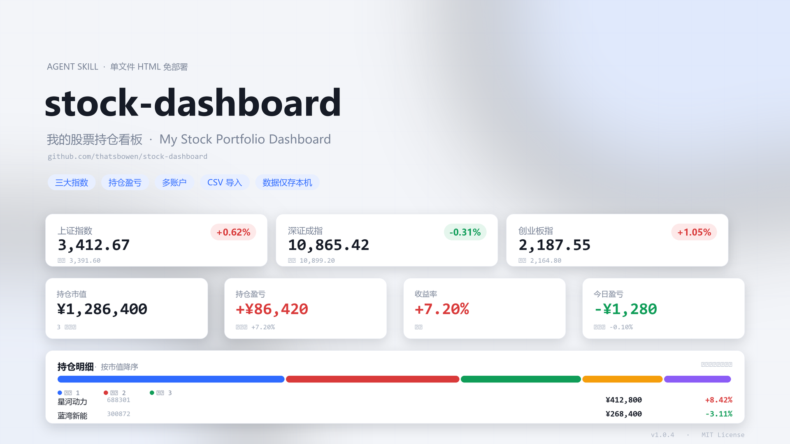

# stock-dashboard-pro · 我的股票持仓看板Pro

[中文](#stock-dashboard-pro--我的股票持仓看板pro) | [English](#stock-dashboard-pro--my-stock-portfolio-dashboard-pro-en)

[](https://skillhub.cn/skills/indiv-bowen/my-stock-portfolio-dashboard)
[](#)
[](LICENSE)



**单文件、免部署的个人 A 股持仓数据看板：** 三大指数 + 持仓市值、持仓盈亏、收益率、今日盈亏一屏呈现，支持多账户切换、持仓占比分布、逐条添加与编辑、CSV 导入、现价刷新；新增**「我的关注」页**——自选股一屏十三项行情指标 + 每只股票的 **AI 分析报告**（五维加权评分、趋势、风险警报、催化因素、操作检查清单）；保留**持仓新闻页**自动汇总所持股票的公告、新闻与大事件。**所有数据只保存在本机浏览器，不上传、不同步。**

| 项目 | 内容 |
|---|---|
| 版本 | 1.2.3 |
| 形态 | 单文件 HTML（内联样式与脚本，无第三方依赖、无需构建） |
| 页面 | 三页：我的关注 / 持仓看板 / 持仓新闻 |
| 行情源 | 腾讯财经 / 东方财富（免密钥公开接口）或自有 API |
| AI 分析 | 内置规则引擎（离线可用）；可选接入 OpenAI 兼容大模型，Key 只存本机 |
| 数据存储 | 浏览器 localStorage（键：`stockboard_standalone_v1` / `stockboard_watch_v1` / `stockboard_settings_v1`） |
| 授权 | MIT |

## 本次更新（1.2.3）

| 更新项 | 说明 |
|---|---|
| 新增：我的关注 | 独立页签，列表 = 所持股票（自动纳入，带「持仓」标签，不可移除）+ 手动添加的股票（「关注」标签，可移除）。一屏展示 **最新价 / 开盘 / 昨收 / 涨跌幅 / 涨跌 / 最高 / 最低 / 涨速 / 换手 / 金额 / 总量 / 现量 / 市盈率** 十三项行情指标；支持弹窗逐只添加、关注 CSV 单列导入（带模板下载）、一键刷新关注行情 |
| 新增：AI 分析报告 | 点任意股票的「AI 分析」，新窗口生成当日报告，分**核心结论、五维评分、趋势、风险警报、催化因素、操作检查清单**六个板块；五维按 **核心竞争力 25% / 行业地位 20% / 产品毛利 15% / 净利润 20% / 未来发展 20%** 加权，总分 0–100 并给出 A–E 评级；报告顶部与底部均有免责声明，仅整理公开数据、不构成投资建议，可打印或存为 PDF；可选接入 OpenAI 兼容大模型撰写「AI 解读」板块，未配置或调用失败时自动回退内置规则引擎并如实标注 |
| 调整：演示数据与页签 | 内置虚构演示数据由 6 条精简为 4 条；页签由 2 个扩为 3 个（我的关注 / 持仓看板 / 持仓新闻），打开后默认仍停在持仓看板 |

同版本其他细节：设置弹窗新增「AI 分析接口（选填 · OpenAI 兼容）」三项配置（Base URL / 模型 / 密钥）；看板标题版本号更新为 V1.2.3；关注页行情改为东方财富与腾讯财经双源，现量与涨速取腾讯分时数据。**持仓看板页与持仓新闻页的功能、字段与交互均与 1.1.6 保持一致。**

## 核心能力

| 能力 | 说明 |
|---|---|
| 三大指数栏 | 上证指数、深证成指、创业板指，含涨跌幅与昨收 |
| 四卡 KPI | 持仓市值、持仓盈亏、投入成本、今日盈亏 |
| 多账户切换 | 按 `账户` 列自动生成切换条，支持 `?acc=账户名` 直达视图 |
| 持仓占比 | 堆叠占比条 + 图例，按当前视图总市值计算 |
| 逐股盈亏表 | 市值降序、右对齐数字、`tabular-nums` 等宽，含合计行；每行带「编辑 / 删除」 |
| 添加持仓 | 逐只录入，保存后自动清除内置演示数据；也可继续追加 |
| 我的关注 | 持仓自动纳入 + 自选股手动添加，十三项行情指标一屏展示，可移除非持仓股 |
| 关注 CSV 导入 | 只需一列 6 位股票代码，自动归一，并支持「下载模板」 |
| AI 分析报告 | 核心结论 / 五维评分 / 趋势 / 风险警报 / 催化因素 / 操作检查清单，含 A–E 评级，可打印与存为 PDF |
| 持仓新闻 | 所持股票的公告 + 新闻 + 大事件，时间倒序，支持类型 / 个股筛选与 1–12 个月时间范围 |
| 现价刷新 | 顶部按钮刷全部；点表格内「现价」只刷单只 |
| 手动兜底 | 行情取不到时弹「更新现价」手填，功能不卡死 |
| CSV 导入 | 整体替换持仓，缺必填列直接拒绝并提示缺哪列 |
| 建议反馈 | 右上角「建议」按钮弹出作者微信二维码（已内嵌，离线可用） |
| 打赏支持 | 添加至少 1 只真实持仓后弹出 ¥5.25 微信收款码（内嵌 base64，每月最多一次），可永久关闭，不影响任何功能 |

## 可导入的智能体平台

本项目遵循通用 Agent Skill 目录规范（`SKILL.md` + `references/` + `scripts/` + `templates/`），可原样导入以下智能体，无需改造：
- **WorkBuddy**
- **OpenClaw**
- **Hermes Agent**
- 其他兼容 `SKILL.md` / Agent Skill 规范的框架

导入方式：把整个 `stock-dashboard` 目录放入智能体的 skills / 技能目录，或将本仓库作为技能源导入。智能体读取 `SKILL.md` frontmatter（`name` / `display_name` / `description` / `examples`）后即可识别"股票看板、持仓收益、盈亏统计、持仓新闻"等触发场景，并按执行流程交付看板。

> 依赖说明：核心交付物为纯前端单文件，**零外部依赖**；`scripts/fetch_quotes.py` 仅在需要命令行拉行情时使用（Python 3.8+，标准库，无需第三方包）。AI 分析报告默认由内置规则引擎生成，不联网、无需任何密钥；仅在用户自行填写 OpenAI 兼容接口后才调用外部大模型。

## SkillHub 展示页

本技能已上架 SkillHub，可在线查看说明、示例与版本信息：

**https://skillhub.cn/skills/indiv-bowen/my-stock-portfolio-dashboard**

## 目录结构

```
stock-dashboard/
├── SKILL.md                        # 技能主文件：能力说明、执行流程、注意事项
├── templates/
│   └── stock-dashboard.html        # 看板成品（单文件，三页，内置 4 条虚构演示数据）
├── references/
│   ├── csv-schema.md               # 持仓 CSV 字段规范
│   ├── api-setup.md                # 行情数据源选择与配置指引
│   ├── watch-ai.md                 # 我的关注与 AI 分析报告的口径说明（列含义、五维权重、合规红线）
│   ├── reward-setup.md             # 微信收款码打赏说明与更换指引
│   └── design-spec.md              # 版式、配色与计算公式规范
├── scripts/
│   └── fetch_quotes.py             # 行情拉取脚本（自有 API / 腾讯公开行情兜底）
├── assets/
│   └── cover.png                   # 项目封面
└── README.md
```

## 快速开始

1. 下载 `templates/stock-dashboard.html`，双击用浏览器打开即可看到完整效果（内置 4 条**虚构演示数据**）。
2. 首次打开会自动弹出「行情设置」，选一个数据源后保存：腾讯财经（默认，免注册）、东方财富（备用）、或自有 API。
3. 点右上角「导入持仓 CSV」，或用「添加持仓」逐只录入，数据写入本机浏览器 localStorage。
4. 点顶部「我的关注」页签，可「＋ 添加关注」逐只录入，或「导入关注 CSV」一次性导入代码清单（可先「下载模板」）；持仓股票自动纳入且不可移除。
5. 在关注列表中点任意股票的「AI 分析」，即可在新窗口查看当日分析报告，可打印或存为 PDF（默认内置规则引擎，无需联网配置）。
6. 点顶部「持仓新闻」页签，即可查看所持股票的公告与新闻（演示数据为虚构标的，不抓新闻；导入真实持仓后自动生效）。

命令行拉取现价（可与看板约定格式一致）：

```bash
# 腾讯公开行情兜底，免密钥
python3 scripts/fetch_quotes.py --codes 688301,300872

# 自有行情 API
python3 scripts/fetch_quotes.py --api "https://your-api.example.com/quote" --key "your-key" --codes 688301

# 指数同样支持
python3 scripts/fetch_quotes.py --codes sh000001,sz399001,sz399006
```

输出：

```json
{"source": "tencent", "quotes": [{"code": "688301", "price": 17.35}]}
```

## 持仓 CSV 字段规范

UTF-8 编码、英文逗号分隔、首行为表头。

| 列名 | 必需 | 类型 | 说明 |
|---|---|---|---|
| 名称 | 是 | 文本 | 股票名称 |
| 代码 | 是 | 文本 | 6 位数字代码（`600519.SH`、`SH600519` 等写法会被归一化，Excel 吃掉前导零的代码可能识别失败） |
| 成本价 | 是 | 数字 | 摊薄成本价（元） |
| 数量 | 是 | 整数 | 当前持股数 |
| 现价 | 否 | 数字 | 最新价，缺省按 0 处理，盈亏显示 — |
| 现价更新时间 | 否 | ISO 时间 | 用于"X 分钟前"与时效判断 |
| 上一现价 | 否 | 数字 | 上一次现价，用于计算今日盈亏 |
| 上一现价日期 | 否 | ISO 时间 | 上一次现价的时间 |
| 账户 | 否 | 文本 | 留空归入"未分配"；多个账户名自动生成切换条 |

```csv
名称,代码,成本价,数量,现价,现价更新时间,上一现价,上一现价日期,账户
星河动力,688301,18.62,2000,17.35,2026-10-29T07:06:24Z,17.02,2026-10-28T07:06:24Z,账户A
蓝湾新能,300872,12.40,3600,14.88,2026-10-29T07:06:24Z,14.52,2026-10-28T07:06:24Z,账户A
长风智驾,002655,33.26,500,29.81,2026-10-29T08:00:00Z,30.24,2026-10-28T07:06:24Z,账户B
```

## 关注 CSV 字段规范

UTF-8 编码，**只需一列 6 位股票代码**，首行可为表头。关注列表仅保存手动添加的部分，持仓股票由持仓数据动态派生。

```csv
代码
600519
000001
300750
```

- 支持 `600519.SH`、`SH600519`、`600519.0`、`1`（Excel 吃掉前导零）等写法，导入时自动归一为 6 位代码。
- 持仓中已存在的代码会自动跳过，避免重复。
- 「下载模板」提供 600519 / 000001 / 300750 / 601318 / 002594 五个示例代码。

## 我的关注行情口径

| 列 | 口径 |
|---|---|
| 最新价 / 开盘 / 昨收 / 最高 / 最低 | 当日实时行情 |
| 涨跌幅 | （最新价 − 昨收）÷ 昨收 |
| 涨跌 | 最新价 − 昨收 |
| 涨速 | 最近 5 分钟涨跌幅（东方财富 f22；兜底时用分时数据 5 分钟差价计算） |
| 换手 / 金额 / 总量 / 市盈率 | 东方财富公开接口字段（市盈率为 f9，TTM / 动态口径） |
| 现量 | 最新一笔成交手数（分时累计量差分） |

- 行情双源：优先东方财富 `push2.eastmoney.com`（含涨速、市值等扩展字段），失败时自动回退腾讯财经 `qt.gtimg.cn`；现量与涨速取腾讯分时接口 `web.ifzq.gtimg.cn`。
- 涨红跌绿（A 股惯例），与持仓页配色一致。

## AI 分析报告

点关注列表中任意股票的「AI 分析」，在新窗口生成当日报告，包含六个板块：**核心结论**（企业概要 + 看好 / 看空依据）、**五维评分**、**趋势**、**风险警报**、**催化因素**、**操作检查清单**；底部注明数据来源与评分口径，支持打印或存为 PDF。

数据来源（全部为公开接口）：

| 数据 | 来源 |
|---|---|
| 财务指标 | 东方财富 `datacenter-web.eastmoney.com`（`RPT_LICO_FN_CPD`：营收 / 净利 / 毛利率 / ROE / 同比 / 所属板块） |
| K 线 | 东方财富 push2 70 日日 K（兜底腾讯 ifzq 前复权） |
| 新闻 | 复用持仓新闻的搜索接口 |

五维评分（0–100，加权总分）：

| 维度 | 构成 | 权重 |
|---|---|---|
| 核心竞争力 | 毛利率分 55% + ROE 分 45% | 25% |
| 行业地位 | 总市值分档（≥5000 亿 95 … <50 亿 40），ROE ≥ 15% 加 3 分 | 20% |
| 产品毛利 | 销售毛利率分档（≥60% 95 … <10% 30） | 15% |
| 净利润 | 净利规模分 40% + 净利同比分 60% | 20% |
| 未来发展 | 营收同比分 50% + 净利同比分 50% | 20% |

- 评级：≥ 85 为 A，≥ 75 为 B，≥ 65 为 C，≥ 55 为 D，其余为 E。
- 趋势：用 MA20 / MA60 相对位置与 20 / 60 日涨跌幅判定（多头排列 / 反弹 / 空头 / 震荡）。
- 合规红线：报告顶部与底部均有免责声明——仅整理公开数据，**不构成投资建议，不引导买入或卖出**，决策与风险由使用者自行承担。
- 大模型（可选）：在「设置」中填写 OpenAI 兼容接口（Base URL / 模型 / 密钥，默认模型 `deepseek-chat`）后，优先由大模型基于上述数据撰写「AI 解读」板块（其系统提示词已禁止买卖推荐）；调用失败或未配置时自动回退内置规则引擎，并在报告中如实标注来源。密钥只存本机浏览器，不上传。

## 行情数据源

| 数据源 | 是否需注册 | 接口 | 说明 |
|---|---|---|---|
| 腾讯财经 | 否 | `qt.gtimg.cn` | 默认源，实时现价 + 三大指数，开箱即用；关注页作为备用源 |
| 东方财富 | 否 | `push2.eastmoney.com` | 备用源，JSONP，数据与腾讯略有差异；关注页首选源（字段更全） |
| 自有 API | 是（用户自备） | 用户自定义 | 请求头 `X-API-Key`，Key 只存在本机浏览器 |

自有 API 返回约定：

```json
GET {接口地址}?codes=688301,300872
{ "quotes": [ { "code": "688301", "price": 17.35 } ] }
```

顶层键兼容 `quotes`、`data` 或直接返回数组。

## 持仓新闻数据来源

| 内容 | 来源 | 说明 |
|---|---|---|
| 公告 | 东方财富公告接口 | 按持仓代码抓取，近 3 个月（可选 1/3/6/12 个月） |
| 新闻 | 东方财富资讯搜索 | 按持仓代码 / 名称检索，取标题、摘要与时间 |
| 大事件 | 标题关键词启发式 | 命中关键词即标记为「大事件」，仅作提示 |

- 结果按发布时间倒序，本地缓存 6 小时；最多跟踪 12 只持仓。
- 抓取失败会在空态提示常见原因（网络拦截、浏览器插件阻止第三方脚本、接口限流）并提供「重新抓取」。
- 新闻与分类来自公开接口与关键词规则，**仅供参考，不构成投资建议**，也不保证 100% 准确。

## 计算与配色规范

- 持仓盈亏 =（现价 − 成本价）× 数量
- 持仓盈亏率 = 持仓盈亏 ÷（成本价 × 数量）× 100%
- 持仓市值 = 现价 × 数量
- 持仓占比 = 该股市值 ÷ 当前视图总市值
- 今日盈亏 =（现价 − 上一现价）× 数量（仅对"上一现价 > 0"的行生效）
- 收益率 = 总盈亏 ÷ 总成本 × 100%
- 关注涨跌幅 =（最新价 − 昨收）÷ 昨收；涨跌 = 最新价 − 昨收

**涨红跌绿**（A 股习惯）：上涨 / 盈利 `#d93a3a`，下跌 / 亏损 `#0f9d58`，阈值 ±0.004。

## 版本记录

| 版本 | 主要变化 |
|---|---|
| 1.2.3 | 新增「我的关注」页（持仓自动纳入 + 自选股手动添加、十三项行情指标、关注 CSV 单列导入与模板、一键刷新）；新增 AI 分析报告（核心结论 / 五维评分 / 趋势 / 风险警报 / 催化因素 / 操作检查清单，五维按 25/20/15/20/20 加权、A–E 评级、可打印与存为 PDF，可选接入 OpenAI 兼容大模型）；设置新增 AI 接口配置；演示数据精简为 4 条 |
| 1.1.6 | 新增持仓新闻页（公告 / 新闻 / 大事件，筛选与时间范围）；新闻结果本地缓存 6 小时、代码归一化与「代码体检」优化抓取效率；表格行内编辑 / 删除；内置打赏入口 |
| 1.0.4 | 三大指数、四卡 KPI、多账户切换、持仓占比、逐股盈亏表、现价刷新与手动兜底、CSV 导入、建议反馈入口 |

## 隐私与边界

- 持仓数据、关注列表、账户名、行情与 AI 设置全部保存在本机浏览器 localStorage，不上传、不联网同步，任何产物都不输出持仓明细。
- 新闻抓取与 AI 分析只把股票代码、名称及公开行情 / 财务摘要发往公开数据接口（或用户在设置中自行填写的模型接口），不发送成本价、数量、账户名等持仓明细。
- 模板内置演示数据（持仓与指数）**均为虚构**，仅用于展示效果，不构成任何投资建议。
- AI 分析报告由本地程序基于公开数据生成，评级与评分仅为量化指标整理，**不构成投资建议，不引导买卖**。
- 不索要、不记录、不转发用户的 API Key（行情 API 与大模型 Key 均只存本机）；自有 API 场景由用户自行注册申请。

## License

MIT License

---

# stock-dashboard-pro · My Stock Portfolio Dashboard Pro (EN)

[中文](#stock-dashboard-pro--我的股票持仓看板pro) | [English](#stock-dashboard-pro--my-stock-portfolio-dashboard-pro-en)

**A single-file, zero-deployment dashboard for your A-share portfolio:** three major indexes plus market value, unrealized P/L, return rate and today's P/L on one screen, with multi-account switching, position weight distribution, per-row add/edit, CSV import and price refresh. It adds a new **Watchlist** tab — thirteen quote metrics per stock plus an **AI analysis report** for any stock (five-dimension weighted score, trend, risk alerts, catalysts, action checklist) — and keeps the **Holdings News** page that aggregates announcements, news and major-event flags for the stocks you hold. **All data stays in your local browser — nothing is uploaded or synced.**

| Item | Detail |
|---|---|
| Version | 1.2.3 |
| Form | Single HTML file (inline CSS/JS, no dependencies, no build step) |
| Pages | Three tabs: Watchlist / Holdings dashboard / Holdings news |
| Quote sources | Tencent Finance / Eastmoney (keyless public endpoints) or your own API |
| AI analysis | Built-in rule engine (works offline); optional OpenAI-compatible endpoint, key stays local |
| Storage | Browser localStorage (keys: `stockboard_standalone_v1` / `stockboard_watch_v1` / `stockboard_settings_v1`) |
| License | MIT |

## What's New in 1.2.3

| Change | Detail |
|---|---|
| New: Watchlist | A dedicated tab. The list is your holdings (added automatically, tagged "持仓", cannot be removed) plus stocks you add manually (tagged "关注", removable). Thirteen metrics on one screen: **latest / open / previous close / change % / change / high / low / speed / turnover / amount / volume / last size / P/E**. Add one stock via a dialog, import a one-column watchlist CSV (with a template download), or refresh all watchlist quotes in one click |
| New: AI analysis report | Click "AI 分析" on any stock to open a same-day report in a new window with six sections: **core conclusion, five-dimension score, trend, risk alerts, catalysts, action checklist**. The five dimensions are weighted **core competitiveness 25% / industry position 20% / product margin 15% / net profit 20% / future growth 20%**, giving a 0–100 total and an A–E grade. Disclaimers sit at both the top and the bottom of the report: public data only, not investment advice. The report can be printed or saved as PDF. An optional OpenAI-compatible model can write the "AI interpretation" section; when unconfigured or on failure it falls back to the built-in rule engine and says so |
| Adjusted: demo data and tabs | Built-in fictional demo rows trimmed from 6 to 4; tabs expanded from 2 to 3 (Watchlist / Holdings dashboard / Holdings news), still opening on the holdings dashboard by default |

Other details in this release: the settings dialog gains an optional "AI analysis endpoint" block (base URL / model / key); the dashboard title shows V1.2.3; watchlist quotes now use Eastmoney first with a Tencent fallback, while last size and speed come from Tencent intraday data. **The Holdings dashboard and Holdings news pages keep the same features, fields and interactions as 1.1.6.**

## Features

| Feature | Description |
|---|---|
| Index strip | SSE Composite, SZSE Component, ChiNext — change % and previous close |
| Four KPI cards | Market value, unrealized P/L, cost basis, today's P/L |
| Multi-account | Switching bar generated automatically from the `账户` column; `?acc=<name>` deep link |
| Position weights | Stacked weight bar plus legend, computed on the current filtered view |
| Holdings table | Sorted by market value, right-aligned `tabular-nums` numbers, totals row, per-row edit / delete |
| Add holdings | One stock at a time; built-in demo rows are cleared once a real holding is saved |
| Watchlist | Holdings added automatically plus manual picks, thirteen quote metrics, non-holding rows removable |
| Watchlist CSV import | A single column of six-digit codes, normalized on import, with a template download |
| AI analysis report | Core conclusion / five-dimension score / trend / risk alerts / catalysts / action checklist, A–E grade, printable and saveable as PDF |
| Holdings news | Announcements, news and major-event flags for your holdings, newest first, filtered by type / stock and 1–12 month range |
| Price refresh | Refresh all from the toolbar, or a single row from its "现价" cell |
| Manual fallback | When quotes fail, a manual price dialog keeps the dashboard usable |
| CSV import | Full replacement of holdings; missing required columns are rejected with a clear message |
| Feedback entry | "建议" button opens the author's WeChat QR code, embedded for offline use |
| Donation | After the first real holding, a ¥5.25 WeChat QR dialog appears (embedded base64, at most once per month) and can be dismissed permanently; nothing is gated behind it |

## Import into Agent Platforms

The repository follows the common Agent Skill layout (`SKILL.md` + `references/` + `scripts/` + `templates/`) and imports as-is into:

- **WorkBuddy**
- **OpenClaw**
- **Hermes Agent**
- Any other framework compatible with the `SKILL.md` / Agent Skill convention

How to import: drop the entire `stock-dashboard` folder into the agent's skills directory, or add this repository as a skill source. The agent reads the frontmatter (`name` / `display_name` / `description` / `examples`) and recognizes triggers such as "stock dashboard", "portfolio P/L", "holdings statistics" or "holdings news".

> Dependencies: the deliverable is a pure front-end single file with **zero external dependencies**. `scripts/fetch_quotes.py` is only needed for command-line quote fetching (Python 3.8+, standard library). The AI report is produced by the built-in rule engine by default — no network, no key; an external model is called only after you enter an OpenAI-compatible endpoint yourself.

## SkillHub Listing

Published on SkillHub — read the documentation, examples and version history online:

**https://skillhub.cn/skills/indiv-bowen/my-stock-portfolio-dashboard**

## Repository Layout

```
stock-dashboard/
├── SKILL.md                        # Skill entry: capabilities, workflow, caveats
├── templates/
│   └── stock-dashboard.html        # The dashboard (single file, three tabs, 4 fictional demo rows)
├── references/
│   ├── csv-schema.md               # Holdings CSV schema
│   ├── api-setup.md                # Quote source selection and setup guide
│   ├── watch-ai.md                 # Watchlist and AI report spec (column meanings, weights, disclaimers)
│   ├── reward-setup.md             # Donation QR code notes and replacement guide
│   └── design-spec.md              # Layout, color and formula spec
├── scripts/
│   └── fetch_quotes.py             # Quote fetcher (own API / Tencent fallback)
├── assets/
│   └── cover.png                   # Project cover
└── README.md
```

## Quick Start

1. Download `templates/stock-dashboard.html` and open it in a browser — four **fictional demo rows** are built in.
2. On first open a "行情设置" dialog appears; pick a source and save: Tencent (default, no sign-up), Eastmoney (backup), or your own API.
3. Click "导入持仓 CSV" or add holdings one by one; everything is written to local browser storage.
4. Open the "我的关注" tab to add picks one by one, or import a watchlist CSV in one shot (a template is provided). Your holdings are included automatically and cannot be removed.
5. Click "AI 分析" on any watchlist row to open today's report in a new window; print it or save it as PDF (the built-in rule engine needs no network or key).
6. Switch to the "持仓新闻" tab to read announcements and news for your holdings (demo rows are fictional and fetch nothing; real holdings activate the page).

Command-line quote fetching (same shape the dashboard expects):

```bash
# Tencent public endpoint, no key required
python3 scripts/fetch_quotes.py --codes 688301,300872

# Your own quote API
python3 scripts/fetch_quotes.py --api "https://your-api.example.com/quote" --key "your-key" --codes 688301

# Indexes work too
python3 scripts/fetch_quotes.py --codes sh000001,sz399001,sz399006
```

Output:

```json
{"source": "tencent", "quotes": [{"code": "688301", "price": 17.35}]}
```

## Holdings CSV Schema

UTF-8, comma separated, header row required.

| Column | Required | Type | Notes |
|---|---|---|---|
| 名称 | Yes | Text | Stock name |
| 代码 | Yes | Text | Six-digit code (`600519.SH`, `SH600519` and similar forms are normalized; codes stripped of leading zeros by Excel may fail) |
| 成本价 | Yes | Number | Diluted cost per share (CNY) |
| 数量 | Yes | Integer | Shares held |
| 现价 | No | Number | Latest price; defaults to 0, P/L shows — |
| 现价更新时间 | No | ISO time | Timestamp used for freshness checks |
| 上一现价 | No | Number | Previous price, used for today's P/L |
| 上一现价日期 | No | ISO time | Timestamp of the previous price |
| 账户 | No | Text | Empty goes to "未分配"; multiple names create the switcher |

## Watchlist CSV Schema

UTF-8, **a single column of six-digit codes**; a header row is optional. Only manually added stocks are stored — holdings are derived from your portfolio data.

```csv
代码
600519
000001
300750
```

- `600519.SH`, `SH600519`, `600519.0`, or `1` (leading zero lost in Excel) are normalized to six-digit codes on import.
- Codes already present in your holdings are skipped automatically.
- The template download ships five sample codes: 600519 / 000001 / 300750 / 601318 / 002594.

## Watchlist Quote Definitions

| Column | Definition |
|---|---|
| Latest / open / previous close / high / low | Intraday quotes |
| Change % | (latest − previous close) ÷ previous close |
| Change | Latest − previous close |
| Speed | Change over the last 5 minutes (Eastmoney f22; intraday 5-minute difference as fallback) |
| Turnover / amount / volume / P/E | Eastmoney public fields (P/E is f9, TTM / dynamic basis) |
| Last size | Shares in the latest trade (derived from intraday cumulative volume) |

- Dual sources: Eastmoney `push2.eastmoney.com` first (richer fields such as speed and market cap), falling back to Tencent `qt.gtimg.cn`; last size and speed come from Tencent intraday `web.ifzq.gtimg.cn`.
- Red for up, green for down (A-share convention), matching the holdings page.

## AI Analysis Report

Click "AI 分析" on any watchlist row to open a same-day report in a new window with six sections: **core conclusion** (company profile plus bull / bear evidence), **five-dimension score**, **trend**, **risk alerts**, **catalysts**, and an **action checklist**. The footer states the data sources and scoring rules; the report can be printed or saved as PDF.

Data sources (public endpoints only):

| Data | Source |
|---|---|
| Fundamentals | Eastmoney `datacenter-web.eastmoney.com` (`RPT_LICO_FN_CPD`: revenue / net profit / gross margin / ROE / YoY / sector) |
| Candlesticks | Eastmoney push2 70 daily bars (Tencent ifzq forward-adjusted as fallback) |
| News | The same search endpoint used by Holdings news |

Five-dimension score (0–100, weighted total):

| Dimension | Composition | Weight |
|---|---|---|
| Core competitiveness | Gross margin score 55% + ROE score 45% | 25% |
| Industry position | Market-cap tiers (≥ CNY 500bn: 95 … < CNY 5bn: 40), +3 when ROE ≥ 15% | 20% |
| Product margin | Gross margin tiers (≥60%: 95 … <10%: 30) | 15% |
| Net profit | Scale score 40% + YoY score 60% | 20% |
| Future growth | Revenue YoY 50% + net profit YoY 50% | 20% |

- Grade: ≥ 85 A, ≥ 75 B, ≥ 65 C, ≥ 55 D, otherwise E.
- Trend: MA20 / MA60 relative position plus 20 / 60-day change (bullish alignment / rebound / bearish / range-bound).
- Compliance: disclaimers appear at the top and bottom of the report — public data only, **not investment advice, no buy or sell recommendation**; decisions and risks rest with the user.
- Optional model: entering an OpenAI-compatible endpoint (base URL / model / key, default model `deepseek-chat`) in Settings lets the model draft the "AI interpretation" section (its system prompt forbids trade recommendations); when unconfigured or on failure the built-in rule engine takes over and the report states which one was used. The key stays in the local browser and is never uploaded.

## Quote Sources

| Source | Sign-up | Endpoint | Notes |
|---|---|---|---|
| Tencent Finance | No | `qt.gtimg.cn` | Default; real-time prices and the three indexes; fallback for the watchlist |
| Eastmoney | No | `push2.eastmoney.com` | Backup, JSONP, slight data differences; primary source for the watchlist (more fields) |
| Own API | Yes (user's own) | Custom | Sends `X-API-Key`; the key never leaves the browser |

Expected response from a custom API:

```json
GET {endpoint}?codes=688301,300872
{ "quotes": [ { "code": "688301", "price": 17.35 } ] }
```

Top-level key may be `quotes`, `data`, or a bare array.

## News Data Sources

| Content | Source | Notes |
|---|---|---|
| Announcements | Eastmoney announcement endpoint | Fetched per holding code, last 3 months by default (1/3/6/12 months optional) |
| News | Eastmoney news search | Searched by holding code / name; title, summary and time |
| Major events | Title-keyword heuristic | Items matching keywords are flagged as "major events" for attention only |

- Sorted newest first, cached locally for 6 hours; up to 12 holdings tracked.
- On failure the empty state lists the usual causes (network blocking, browser extensions blocking third-party scripts, rate limiting) and offers a re-fetch.
- News and classification come from public endpoints and keyword rules: **reference only, not investment advice**, and not guaranteed to be 100% accurate.

## Formulas and Color Rules

- Unrealized P/L = (price − cost) × shares
- P/L % = P/L ÷ (cost × shares) × 100%
- Market value = price × shares
- Weight = position value ÷ total value of the current view
- Today's P/L = (price − previous price) × shares (rows with previous price > 0 only)
- Total return = total P/L ÷ total cost × 100%
- Watchlist change % = (latest − previous close) ÷ previous close; change = latest − previous close

**Red for up, green for down** (A-share convention): gains `#d93a3a`, losses `#0f9d58`, threshold ±0.004.

## Version History

| Version | Highlights |
|---|---|
| 1.2.3 | Watchlist tab (holdings included automatically plus manual picks, thirteen quote metrics, one-column CSV import with template, one-click refresh); AI analysis report (core conclusion / five-dimension score / trend / risk alerts / catalysts / action checklist, weighted 25/20/15/20/20, A–E grade, printable and saveable as PDF, optional OpenAI-compatible model); AI endpoint block in Settings; demo rows trimmed to 4 |
| 1.1.6 | Holdings news page (announcements / news / major events with filters and time ranges); 6-hour local news cache, code normalization and "code check" for efficient fetching; per-row edit and delete; built-in donation entry |
| 1.0.4 | Index strip, four KPI cards, multi-account switching, position weights, holdings table, price refresh with manual fallback, CSV import, feedback entry |

## Privacy and Scope

- Holdings, watchlist, account names, quote and AI settings live only in the local browser; nothing is uploaded or synced, and no artifact ever prints your holdings.
- News fetching and AI analysis send only stock codes, names and public quote / financial summaries to public endpoints (or to the model endpoint you configure in Settings) — never cost, shares, account names or other position details.
- Built-in demo data (positions and indexes) is **fictional**, shown for illustration only and not investment advice.
- The AI report is generated locally from public data; scores and grades are a summary of quantitative metrics, **not investment advice and not a buy or sell recommendation**.
- API keys (quote API and model key) are never requested, stored or forwarded by the skill; users register their own.

## License

MIT License
