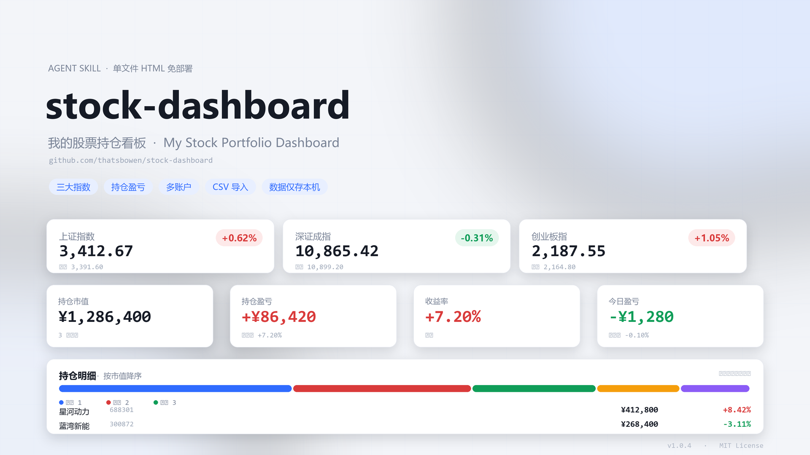

# stock-dashboard · 我的股票持仓看板

[中文](#stock-dashboard--我的股票持仓看板) | [English](#stock-dashboard--my-stock-portfolio-dashboard-en)

[](https://skillhub.cn/skills/indiv-bowen/my-stock-portfolio-dashboard)
[](#)
[](LICENSE)



**单文件、免部署的个人 A 股持仓数据看板：** 三大指数 + 持仓市值、持仓盈亏、收益率、今日盈亏一屏呈现，支持多账户切换、持仓占比分布、CSV 导入、现价刷新。**所有持仓数据只保存在本机浏览器，不上传、不同步。**

| 项目 | 内容 |
|---|---|
| 版本 | 1.0.4 |
| 形态 | 单文件 HTML（内联样式与脚本，无第三方依赖、无需构建） |
| 行情源 | 腾讯财经 / 东方财富（免密钥公开接口）或自有 API |
| 数据存储 | 浏览器 localStorage（键：`stockboard_standalone_v1`） |
| 授权 | MIT |

## 核心能力

| 能力 | 说明 |
|---|---|
| 三大指数栏 | 上证指数、深证成指、创业板指，含涨跌幅与昨收 |
| 四卡 KPI | 持仓市值、持仓盈亏、投入成本、今日盈亏 |
| 多账户切换 | 按 `账户` 列自动生成切换条，支持 `?acc=账户名` 直达视图 |
| 持仓占比 | 堆叠占比条 + 图例，按当前视图总市值计算 |
| 逐股盈亏表 | 市值降序、右对齐数字、`tabular-nums` 等宽，含合计行 |
| 现价刷新 | 顶部按钮刷全部；点表格内「现价」只刷单只 |
| 手动兜底 | 行情取不到时弹「更新现价」手填，功能不卡死 |
| CSV 导入 | 整体替换持仓，缺必填列直接拒绝并提示缺哪列 |
| 建议反馈 | 右上角「建议」按钮弹出作者微信二维码（已内嵌，离线可用） |

## 可导入的智能体平台

本项目遵循通用 Agent Skill 目录规范（`SKILL.md` + `references/` + `scripts/` + `templates/`），可原样导入以下智能体，无需改造：

- **WorkBuddy**
- **OpenClaw**
- **Hermes Agent**
- 其他兼容 `SKILL.md` / Agent Skill 规范的框架

导入方式：把整个 `stock-dashboard` 目录放入智能体的 skills / 技能目录，或将本仓库作为技能源导入。智能体读取 `SKILL.md` frontmatter（`name` / `display_name` / `description` / `examples`）后即可识别"股票看板、持仓收益、盈亏统计"等触发场景，并按执行流程交付看板。

> 依赖说明：核心交付物为纯前端单文件，**零外部依赖**；`scripts/fetch_quotes.py` 仅在需要命令行拉行情时使用（Python 3.8+，标准库，无需第三方包）。

## SkillHub 展示页

本技能已上架 SkillHub，可在线查看说明、示例与版本信息：

**https://skillhub.cn/skills/indiv-bowen/my-stock-portfolio-dashboard**

## 目录结构

```
stock-dashboard/
├── SKILL.md                        # 技能主文件：能力说明、执行流程、注意事项
├── templates/
│   └── stock-dashboard.html        # 看板成品（单文件，内置 6 条虚构演示数据）
├── references/
│   ├── csv-schema.md               # 持仓 CSV 字段规范
│   ├── api-setup.md                # 行情数据源选择与配置指引
│   └── design-spec.md              # 版式、配色、计算公式规范
├── scripts/
│   └── fetch_quotes.py             # 行情拉取脚本（自有 API / 腾讯公开行情兜底）
├── assets/
│   └── cover.png                   # 项目封面
└── README.md
```

## 快速开始

1. 下载 `templates/stock-dashboard.html`，双击用浏览器打开即可看到完整效果（内置 6 条**虚构演示数据**）。
2. 首次打开会自动弹出「行情设置」，选一个数据源后保存：腾讯财经（默认，免注册）、东方财富（备用）、或自有 API。
3. 点右上角「导入持仓 CSV」换成自己的持仓，数据写入本机浏览器 localStorage。

命令行拉取现价（可与看板约定格式一致）：

```bash
# 腾讯公开行情兜底，免密钥
python3 scripts/fetch_quotes.py --codes 688301,300872

# 自有行情 API
python3 scripts/fetch_quotes.py --api "https://your-api.example.com/quote" --key "your-key" --codes 688301

# 指数同样支持
python3 scripts/fetch_quotes.py --codes sh000001,sz399001,sz399006
```

输出：

```json
{"source": "tencent", "quotes": [{"code": "688301", "price": 17.35}]}
```

## 持仓 CSV 字段规范

UTF-8 编码、英文逗号分隔、首行为表头。

| 列名 | 必需 | 类型 | 说明 |
|---|---|---|---|
| 名称 | 是 | 文本 | 股票名称 |
| 代码 | 是 | 文本 | 6 位数字代码（仅纯数字代码可参与行情刷新） |
| 成本价 | 是 | 数字 | 摊薄成本价（元） |
| 数量 | 是 | 整数 | 当前持股数 |
| 现价 | 否 | 数字 | 最新价，缺省按 0 处理，盈亏显示 — |
| 现价更新时间 | 否 | ISO 时间 | 用于"X 分钟前"与时效判断 |
| 上一现价 | 否 | 数字 | 上一次现价，用于计算今日盈亏 |
| 上一现价日期 | 否 | ISO 时间 | 上一次现价的时间 |
| 账户 | 否 | 文本 | 留空归入"未分配"；多个账户名自动生成切换条 |

```csv
名称,代码,成本价,数量,现价,现价更新时间,上一现价,上一现价日期,账户
星河动力,688301,18.62,2000,17.35,2026-10-29T07:06:24Z,17.02,2026-10-28T07:06:24Z,账户A
蓝湾新能,300872,12.40,3600,14.88,2026-10-29T07:06:24Z,14.52,2026-10-28T07:06:24Z,账户A
长风智驾,002655,33.26,500,29.81,2026-10-29T08:00:00Z,30.24,2026-10-28T07:06:24Z,账户B
```

## 行情数据源

| 数据源 | 是否需注册 | 接口 | 说明 |
|---|---|---|---|
| 腾讯财经 | 否 | `qt.gtimg.cn` | 默认源，实时现价 + 三大指数，开箱即用 |
| 东方财富 | 否 | `push2.eastmoney.com` | 备用源，JSONP，数据与腾讯略有差异 |
| 自有 API | 是（用户自备） | 用户自定义 | 请求头 `X-API-Key`，Key 只存在本机浏览器 |

自有 API 返回约定：

```json
GET {接口地址}?codes=688301,300872
{ "quotes": [ { "code": "688301", "price": 17.35 } ] }
```

顶层键兼容 `quotes`、`data` 或直接返回数组。

## 计算与配色规范

- 持仓盈亏 =（现价 − 成本价）× 数量
- 持仓盈亏率 = 持仓盈亏 ÷（成本价 × 数量）× 100%
- 持仓市值 = 现价 × 数量
- 持仓占比 = 该股市值 ÷ 当前视图总市值
- 今日盈亏 =（现价 − 上一现价）× 数量（仅对"上一现价 > 0"的行生效）
- 收益率 = 总盈亏 ÷ 总成本 × 100%

**涨红跌绿**（A 股习惯）：上涨 / 盈利 `#d93a3a`，下跌 / 亏损 `#0f9d58`，阈值 ±0.004。

## 隐私与边界

- 持仓数据、账户名、行情设置全部保存在本机浏览器 localStorage，不上传、不联网同步，任何产物都不输出持仓明细。
- 模板内置演示数据（持仓与指数）**均为虚构**，仅用于展示效果，不构成任何投资建议。
- 不索要、不记录、不转发用户的 API Key；自有 API 场景由用户自行注册申请。

## License

MIT License

---

# stock-dashboard · My Stock Portfolio Dashboard (EN)

[中文](#stock-dashboard--我的股票持仓看板) | [English](#stock-dashboard--my-stock-portfolio-dashboard-en)

**A single-file, zero-deployment dashboard for your A-share portfolio:** three major indexes plus market value, unrealized P/L, return rate and today's P/L on one screen, with multi-account switching, position weight distribution, CSV import and price refresh. **All holdings stay in your local browser — nothing is uploaded or synced.**

| Item | Detail |
|---|---|
| Version | 1.0.4 |
| Form | Single HTML file (inline CSS/JS, no dependencies, no build step) |
| Quote sources | Tencent Finance / Eastmoney (keyless public endpoints) or your own API |
| Storage | Browser localStorage (key: `stockboard_standalone_v1`) |
| License | MIT |

## Features

| Feature | Description |
|---|---|
| Index strip | SSE Composite, SZSE Component, ChiNext — change % and previous close |
| Four KPI cards | Market value, unrealized P/L, cost basis, today's P/L |
| Multi-account | Switching bar generated automatically from the `账户` column; `?acc=<name>` deep link |
| Position weights | Stacked weight bar plus legend, computed on the current filtered view |
| Holdings table | Sorted by market value, right-aligned `tabular-nums` numbers, totals row |
| Price refresh | Refresh all from the toolbar, or a single row from its "现价" cell |
| Manual fallback | When quotes fail, a manual price dialog keeps the dashboard usable |
| CSV import | Full replacement of holdings; missing required columns are rejected with a clear message |
| Feedback entry | "建议" button opens the author's WeChat QR code, embedded for offline use |

## Import into Agent Platforms

The repository follows the common Agent Skill layout (`SKILL.md` + `references/` + `scripts/` + `templates/`) and imports as-is into:

- **WorkBuddy**
- **OpenClaw**
- **Hermes Agent**
- Any other framework compatible with the `SKILL.md` / Agent Skill convention

How to import: drop the entire `stock-dashboard` folder into the agent's skills directory, or add this repository as a skill source. The agent reads the frontmatter (`name` / `display_name` / `description` / `examples`) and recognizes triggers such as "stock dashboard", "portfolio P/L" or "holdings statistics".

> Dependencies: the deliverable is a pure front-end single file with **zero external dependencies**. `scripts/fetch_quotes.py` is only needed for command-line quote fetching (Python 3.8+, standard library).

## SkillHub Listing

Published on SkillHub — read the documentation, examples and version history online:

**https://skillhub.cn/skills/indiv-bowen/my-stock-portfolio-dashboard**

## Repository Layout

```
stock-dashboard/
├── SKILL.md                        # Skill entry: capabilities, workflow, caveats
├── templates/
│   └── stock-dashboard.html        # The dashboard (single file, 6 fictional demo rows)
├── references/
│   ├── csv-schema.md               # Holdings CSV schema
│   ├── api-setup.md                # Quote source selection and setup guide
│   └── design-spec.md              # Layout, color and formula spec
├── scripts/
│   └── fetch_quotes.py             # Quote fetcher (own API / Tencent fallback)
├── assets/
│   └── cover.png                   # Project cover
└── README.md
```

## Quick Start

1. Download `templates/stock-dashboard.html` and open it in a browser — six **fictional demo rows** are built in.
2. On first open a "行情设置" dialog appears; pick a source and save: Tencent (default, no sign-up), Eastmoney (backup), or your own API.
3. Click "导入持仓 CSV" to replace the demo data; everything is written to local browser storage.

Command-line quote fetching (same shape the dashboard expects):

```bash
# Tencent public endpoint, no key required
python3 scripts/fetch_quotes.py --codes 688301,300872

# Your own quote API
python3 scripts/fetch_quotes.py --api "https://your-api.example.com/quote" --key "your-key" --codes 688301

# Indexes work too
python3 scripts/fetch_quotes.py --codes sh000001,sz399001,sz399006
```

Output:

```json
{"source": "tencent", "quotes": [{"code": "688301", "price": 17.35}]}
```

## Holdings CSV Schema

UTF-8, comma separated, header row required.

| Column | Required | Type | Notes |
|---|---|---|---|
| 名称 | Yes | Text | Stock name |
| 代码 | Yes | Text | Six-digit code (only plain numeric codes can be refreshed) |
| 成本价 | Yes | Number | Diluted cost per share (CNY) |
| 数量 | Yes | Integer | Shares held |
| 现价 | No | Number | Latest price; defaults to 0, P/L shows — |
| 现价更新时间 | No | ISO time | Timestamp used for freshness checks |
| 上一现价 | No | Number | Previous price, used for today's P/L |
| 上一现价日期 | No | ISO time | Timestamp of the previous price |
| 账户 | No | Text | Empty goes to "未分配"; multiple names create the switcher |

## Quote Sources

| Source | Sign-up | Endpoint | Notes |
|---|---|---|---|
| Tencent Finance | No | `qt.gtimg.cn` | Default; real-time prices and the three indexes |
| Eastmoney | No | `push2.eastmoney.com` | Backup, JSONP, slight data differences |
| Own API | Yes (user's own) | Custom | Sends `X-API-Key`; the key never leaves the browser |

Expected response from a custom API:

```json
GET {endpoint}?codes=688301,300872
{ "quotes": [ { "code": "688301", "price": 17.35 } ] }
```

Top-level key may be `quotes`, `data`, or a bare array.

## Formulas and Color Rules

- Unrealized P/L = (price − cost) × shares
- P/L % = P/L ÷ (cost × shares) × 100%
- Market value = price × shares
- Weight = position value ÷ total value of the current view
- Today's P/L = (price − previous price) × shares (rows with previous price > 0 only)
- Total return = total P/L ÷ total cost × 100%

**Red for up, green for down** (A-share convention): gains `#d93a3a`, losses `#0f9d58`, threshold ±0.004.

## Privacy and Scope

- Holdings, account names and quote settings live only in the local browser; nothing is uploaded or synced, and no artifact ever prints your holdings.
- Built-in demo data (positions and indexes) is **fictional**, shown for illustration only and not investment advice.
- API keys are never requested, stored or forwarded by the skill; users register their own.

## License

MIT License
